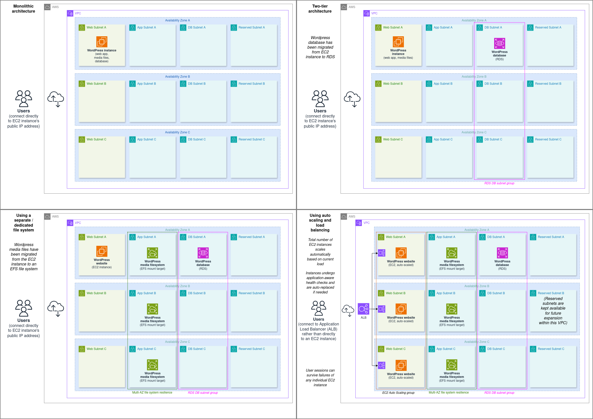

# OpenTofu (Terraform) IaC Projects

## [WordPress Cloud Architectures](./wordpress-cloud-architectures/)

This is a collection of modules representing the progression from a monolithic WordPress architecture into a much more resilient and scalable design.
It also includes GitHub Actions for automated infrastructure deployment.

